<a href="https://github.com/henriqqw">
  <picture>
    <source media="(prefers-color-scheme: dark)" srcset="https://raw.githubusercontent.com/henriqqw/henriqqw/main/dark_mode.svg">
    
  </picture>
</a>

> Full Stack Software Engineer focused on performance, scalability, offensive security, system design, and automation.
> Building platforms, tools, and experiments around modern web systems and emerging attack surfaces.

